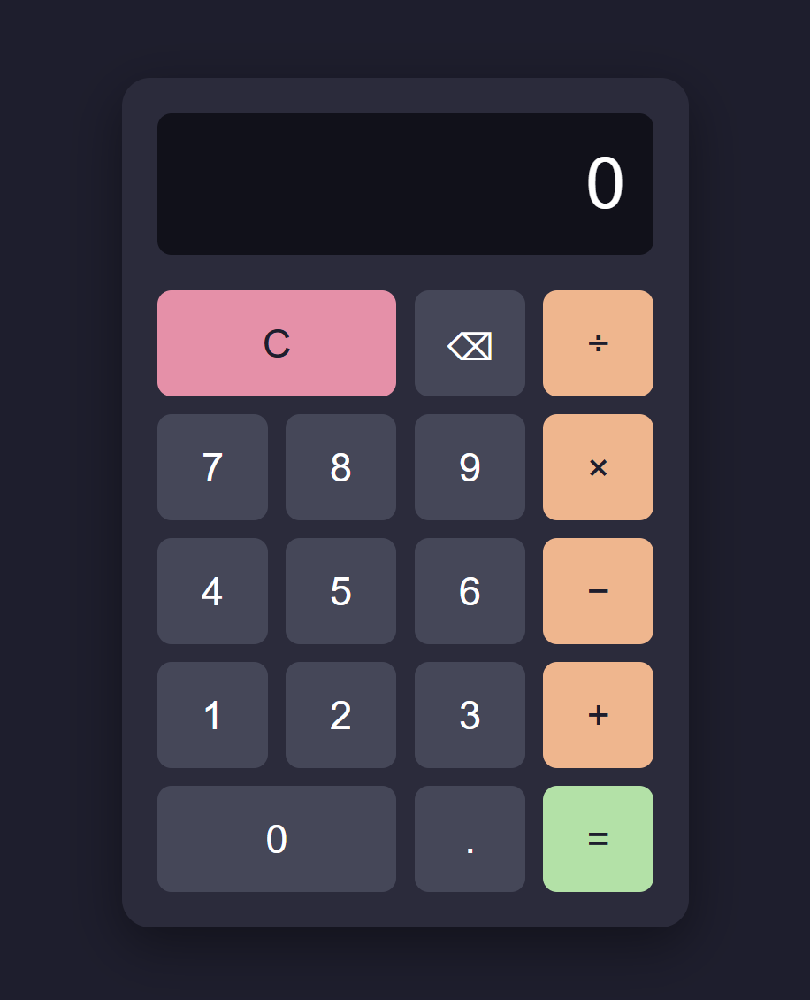

# Calculator

An on-screen calculator built with HTML, CSS and vanilla JavaScript, as the final project of [The Odin Project](https://www.theodinproject.com/lessons/foundations-calculator) Foundations course.

**Live demo:** [your-username.github.io/calculator](https://kho10-16.github.io/odin-calculator//)

## Features

- Addition, subtraction, multiplication and division
- Chained operations: `12 + 7 - 1 =` evaluates one pair at a time (`19`, then `18`)
- Pressing an operator twice in a row only keeps the last one, no accidental evaluation
- Starting a new number after a result begins a fresh calculation
- Results rounded to 8 decimal places so they don't overflow the display
- A snarky message instead of a crash when dividing by zero
- Clear button that fully resets the calculator
- Decimal input, with only one decimal point allowed per number
- Backspace to undo the last digit
- Keyboard support

## Keyboard shortcuts

| Key | Action |
| --- | --- |
| `0`–`9` | Enter a digit |
| `.` | Decimal point |
| `+` `-` `*` `/` | Choose an operator |
| `Enter` or `=` | Calculate |
| `Backspace` | Delete last digit |
| `Escape` | Clear everything |

## Built with

- HTML
- CSS (Flexbox and Grid)
- JavaScript (no libraries, no `eval()`)

## What I learned

- Managing state with a few variables (`firstNumber`, `operator`, `secondNumber`, `justCalculated`) and keeping them consistent across every button press
- Handling edge cases, such as pressing `=` too early, repeated operators, dividing by zero and floating-point rounding (`0.1 + 0.2`)
- Using `data-*` attributes to separate what the user sees (`×`) from what the code uses (`*`)
- Listening for keyboard events and using `preventDefault()` to stop a focused button from being clicked again on `Enter`
- Refactoring repeated logic into reusable functions such as `pressEquals()` and `addDigitTo()`

## Possible improvements

- Show the full expression (e.g. `12 + 7`) above the current number
- Visually disable the `.` button when a decimal point is already present
- Shrink the font for very large numbers instead of cutting them off
- Add a percentage and +/− (sign toggle) button

## Acknowledgements

Project specification by [The Odin Project](https://www.theodinproject.com/).